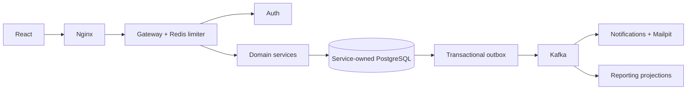

# Architecture and implementation plan
React → Nginx → Spring Cloud Gateway → ten independently deployed business services.
Each service owns a PostgreSQL database and DB login. Foreign identifiers are UUID references, never cross-database joins. Shared library contains transport security, JSON record persistence and outbox mechanics; domain controllers and migrations remain service-owned.

Plan: establish isolated databases and authentication; implement registration, slots and constrained booking; add outbox and idempotent projections; clinical, inventory and billing commands; connect role-aware UI; package delivery and operational guidance; execute available validation.

HTTP controllers delegate to transactional application services. Service-owned repositories isolate JPA and SQL. The shared Hibernate ClinicalResource aggregate maps JSONB records; dedicated slot/booking, auth/token, stock/movement, payment and projection tables enforce critical constraints. Typed command DTOs provide boundary validation. DirectoryClient validates cross-service references and assigned-care access while propagating the caller's token. See PROJECT-STRUCTURE.md for actual packages and SCOPE.md for remaining access and scaling limitations.
